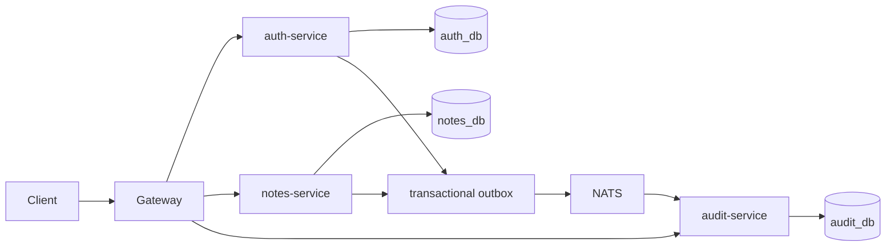

# Architecture

## Ownership

The gateway is the only public HTTP entry point. Auth, notes, and audit own separate PostgreSQL databases; service code must not query another service's tables. `packages/*` contains cross-cutting infrastructure and contracts, not feature-specific business rules.

## Service layers

HTTP adapters parse external input and map errors. Application services coordinate domain operations. Domain types and ports define rules and persistence contracts. Infrastructure implements ports using PostgreSQL, NATS, cryptographic keys, and external services. `main.ts` is the composition root.

## Request and event flow

The gateway forwards authentication requests to auth-service. Auth-service hashes passwords with Argon2id and signs short-lived EdDSA access tokens. Notes-service validates the signature through the auth JWKS endpoint and scopes reads and writes to the verified subject. Updates use a version field to reject stale writes.

User and note events are inserted into the owning service's outbox in the same SQL transaction as the business change. The relay publishes later; consumers must deduplicate by `eventId`. The relay and audit consumer modules are starter components and require production JetStream durability and retry/DLQ policy before production use.

## Health

`/healthz` reports process liveness. Internal services' `/readyz` checks database connectivity. The gateway aggregates readiness from its configured downstream services.
